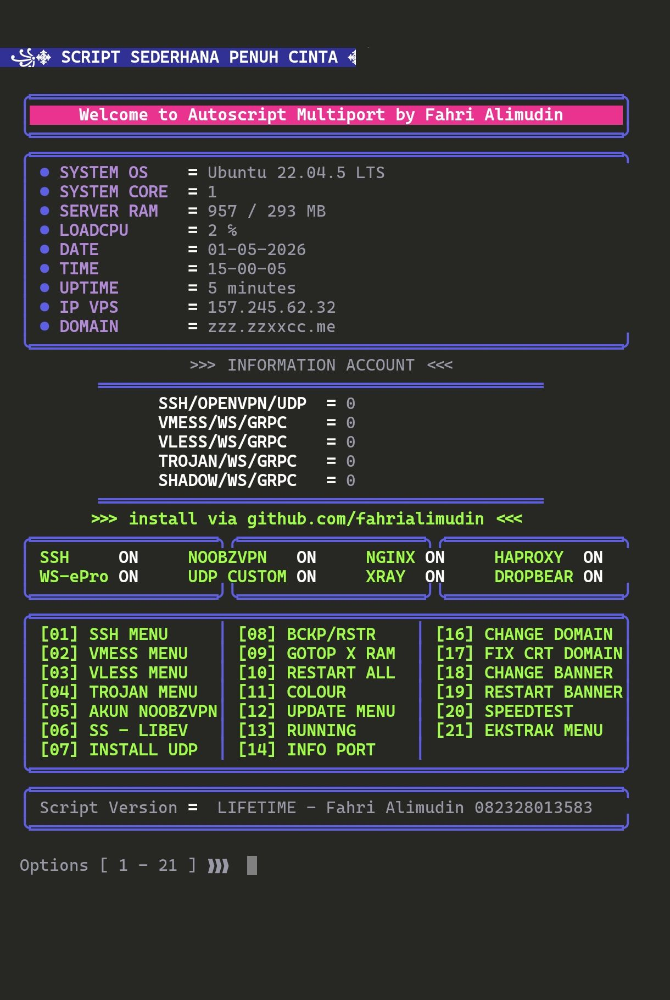

# 🚀 SCRIPT AUTO INSTALL SSH & XRAY MULTIPORT

**Base Script by:** Arya Blitar  
**Modified by:** Fahri Alimudin  
**Port Debian 12 by:** fork ini — ditambahkan dukungan Debian 12 (bookworm). Ubuntu 22.04/24.04 tetap didukung. Debian 11 tidak didukung (OpenSSL 1.1.1 & glibc 2.31 terlalu tua untuk sebagian binary bawaan script ini).

> ⚠️ **Sebelum upload ke GitHub:** ganti `USERNAME` dan `NAMA-REPO` di `setup.sh` (baris `REPO=...`, sekitar baris 150) dengan username GitHub dan nama repo fork kamu, supaya installer mengambil semua file dari repo kamu sendiri.

## 📥 CARA INSTALL DARI FORK INI (Debian 12 / Ubuntu 22.04 / 24.04)

Login ke VPS sebagai **root**, lalu jalankan:

```
apt update -y && apt install -y wget curl ca-certificates && wget -q https://raw.githubusercontent.com/harimu63/SRX_SCRIPT/main/setup.sh && chmod +x setup.sh && ./setup.sh
```

(Ganti `USERNAME/NAMA-REPO` dengan repo fork kamu. Atau clone repo ini lalu jalankan `./setup.sh` dari dalam folder hasil clone — file-file lain akan diambil dari folder lokal.)

---

## 📢 PERHATIAN
Mohon baca sampai selesai sebelum melakukan instalasi!

---

## 💻 OS SUPPORT & SPESIFIKASI

<p align="center">
  
  <br/>
  
  
  
</p>

⚡ **CPU:** Minimal 1 Core  
🧠 **RAM:** Minimal 1GB  
🌐 **Domain:** Wajib Pointing ke IP VPS  

### SETTING DOMAIN DI CLOUDFLARE
- SSL/TLS : **FULL**
- SSL/TLS Recommender : **OFF**
- GRPC : **ON**
- WEBSOCKET : **ON**
- Always Use HTTPS : **OFF**
- UNDER ATTACK MODE : **OFF**

---

## 📊 DAFTAR SERVICE & PORT LENGKAP

| Nama Service                   | Port / Protokol                        |
|--------------------------------|----------------------------------------|
| 🔑 OpenSSH                     | 22, 2222, 2223                         |
| 🛡️ Dropbear                   | 109, 143                               |
| 🌐 SSH WS / Xray WS (HTTP)     | 80, 55, 8880, 2082                     |
| 🔐 SSH WSS / Xray WSS (HTTPS)  | 443, 8443, 2087, 2096                  |
| 🚀 Xray Vless WS               | 80 (None TLS) / 443 (TLS)             |
| 🚀 Xray Vmess WS               | 80 (None TLS) / 443 (TLS)             |
| 🚀 Xray Trojan WS              | 80 (None TLS) / 443 (TLS)             |
| 🚀 Xray Shadowsocks WS         | 80 (None TLS) / 443 (TLS)             |
| 🧬 Xray Vless gRPC             | 443, 8443, 2087, 2096                  |
| 🧬 Xray Vmess gRPC             | 443, 8443, 2087, 2096                  |
| 🧬 Xray Trojan gRPC            | 443, 8443, 2087, 2096                  |
| 🧬 Xray Shadowsocks gRPC       | 443, 8443, 2087, 2096                  |
| 🌍 OpenVPN TCP                 | 1194                                   |
| 🌍 OpenVPN UDP                 | 2200                                   |
| ⚙️ Nginx (Panel)              | 81                                     |
| 🐢 SlowDNS                     | 5300 (UDP)                             |

---

## 🛠️ CARA INSTALLASI (BASH SCRIPT)

Login ke VPS Anda sebagai **root** (`sudo su`), lalu salin dan jalankan kode berikut:

```bash
apt update -y && apt install -y wget curl ca-certificates && wget -q https://raw.githubusercontent.com/harimu63/SRX_SCRIPT/main/setup.sh && chmod +x setup.sh && ./setup.sh
```

> ✅ Kode di atas bisa langsung di-copy dengan mengklik ikon salin di pojok kanan blok kode.

---

## 📱 TAMPILAN MENU

<p align="center">
  
</p>

---

## ✨ FITUR UTAMA

- 🌐 **Nginx** — Web server & reverse proxy  
- 💨 **Speedtest VPS** by Ookla  
- 🔒 **SSL Let's Encrypt** — Sertifikat SSL otomatis  
- ⚡ **Xray Core** — Versi terbaru (Vless, Vmess, Trojan, Shadowsocks)  
- 🔑 **OpenSSH** — Multi port (22, 2222, 2223)  
- 🛡️ **Dropbear** — SSH ringan port 109 & 143  
- 🌍 **OpenVPN** — TCP & UDP  
- 🌐 **ePro WebSocket Proxy** — SSH over WebSocket  
- 🐢 **SlowDNS** — Tunnel via DNS  
- 📊 **Vnstat** — Monitoring bandwidth  
- 🔐 **Fail2ban** — Proteksi brute force  
- 🔄 **Auto Reboot & Restart** — Semua service  
- 🧹 **Auto Delete Expired User**  
- 💾 **Auto Backup via Telegram Bot** — Backup otomatis ke Telegram (keep 3 terakhir)  
- 🚦 **Limit IP & Quota** per user  
- 🧠 **Swap Memory 1GB** — Optimasi RAM  
- 🚀 **BBRPLUS** — Optimasi kecepatan jaringan  
- 🌐 **DNS Changer**  
- 🎨 **Custom Menu Color**  

---

## 🔄 UPDATE OTOMATIS UNTUK USER LAMA

User yang sudah install script lama **tidak perlu install ulang!** Cukup jalankan update menu:

```bash
# Update menu script
menu → [12] UPDATE MENU

# Atau langsung
update-menu
```

**Yang akan terjadi saat update:**
- ✅ Semua menu file ter-update
- ✅ Telegram Backup handler ter-install otomatis
- ✅ Dependencies (jq, bc) ter-install jika belum ada
- ✅ Notifikasi fitur baru muncul
- ✅ Config lama tetap aman (tidak terhapus)

**Setelah update, setup Telegram Bot:**
```bash
menu → [8] BCKP/RSTR → [3] Auto Backup → [1] Setup Telegram Bot
```

---

## 📱 FITUR BARU: TELEGRAM BACKUP SYSTEM

Script ini menggunakan **Telegram Bot** untuk backup/restore, menggantikan sistem email yang lama.

### Keunggulan:
- ✅ **Gratis & Reliable** — Tidak perlu setup SMTP/Google Drive
- ✅ **Auto Backup** — Jam 03:00 WIB setiap hari
- ✅ **Keep 3 Backup** — Auto delete backup lama
- ✅ **Easy Restore** — Pilih dari list atau input file_id
- ✅ **Real-time Notification** — Notif langsung ke Telegram

### Setup Cepat (2 menit):
1. Buat bot di **@BotFather** → dapat BOT_TOKEN
2. Chat bot Anda → get CHAT_ID dari **@userinfobot**
3. Di VPS: `menu` → [8] BCKP/RSTR → [3] Auto Backup → [1] Setup Telegram Bot
4. Masukkan BOT_TOKEN & CHAT_ID → Done!

📖 **Dokumentasi Lengkap:** [TELEGRAM-BACKUP-GUIDE.md](./TELEGRAM-BACKUP-GUIDE.md)

---

## 📞 KONTAK & BANTUAN

Jika ada pertanyaan atau butuh bantuan, hubungi saya di:

- 🟢 **WhatsApp:** [https://wa.me/6282328013583](https://wa.me/6282328013583)
- 🔵 **Telegram:** [@fahrialimudin](https://t.me/fahrialimudin)

---

## 🙏 PENUTUP & KREDIT

Terima kasih banyak kepada **ARYA BLITAR** atas script dasarnya yang luar biasa sehingga saya bisa melakukan modifikasi ini.

Gunakan script ini dengan bijak. Dilarang keras untuk diperjualbelikan karena script ini didapatkan secara gratis.

> © 2026 Fahri Alimudin - Autoscript VIP
